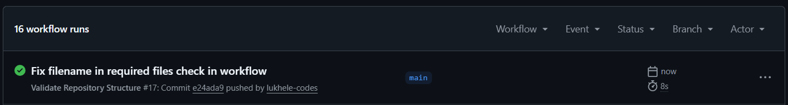
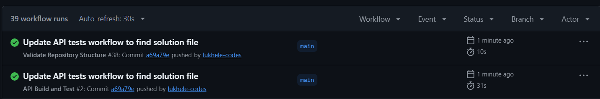

# RaceDaySystem
RaceDay is a full stack event management platform for South Africa's road running, walking, and cycling community

System Description
RaceDay is a fullstack, web-based event management platform for the South African road running, walking, and cycling community. It allows Event Organisers to create and manage events, define categories per event, capture participant results, and view enrolment rosters. Participants can browse upcoming events, enrol in a category, track their own enrolment and result history, and prepare for race day.

Entity Relationship Diagram
See docs/erd.png. The data model consists of six entities: Roles, Users, Events, Categories, Enrolments, and Results. Key design decisions:
Roles is a lookup table rather than a text column on Users, keeping role names consistent and easy to extend.
Users is a single table for both Organisers and Participants, distinguished by RoleId, to avoid duplicating shared columns.
Categories belongs to an Event (e.g. a "10km" or "21km" category within a specific race), and Participants enrol into a Category, not directly into an Event.
Enrolments links a Participant to a Category, with a UNIQUE constraint preventing duplicate enrolment in the same category.
Results has a strict 1:1 relationship with Enrolments (one result per enrolment), captured by an Organiser after race day.

API Endpoint Plan

See docs/API Endpoint Plan 6.md for the full table of endpoints covering Authentication, User Profile, Events, Categories, Event Enrolments, and Results, including HTTP method, route, role required, request body, and expected response for each.

SQL Database Script
See docs/RaceDay.sql. The script:
Creates the RaceDayDB database and all six tables matching the ERD exactly.
Defines all primary keys, foreign keys, and constraints (NOT NULL, UNIQUE, DEFAULT).
Seeds the database with realistic sample data: 2 Organisers, 2 Participants, 3 Events, 5 Categories, 4 Enrolments, and 2 Results.

**CI Screenshot:**  

**Youtube Link:**
https://youtu.be/C8BJRqQNRoI

 Part 2 - RaceDay API

The RaceDay API is built with ASP.NET Core Web API in C# and uses SQL Server through Entity Framework Core with the code first approach. It handles registration, login, events, categories, enrolments and results, with different access for Organisers and Participants.

YouTube video: https://youtu.be/KcHu7c_NCFc

Steps:
1. Clone the repository: https://github.com/lukhele-codes/RaceDaySystem
2. Open the solution file in the Part 2 folder in Visual Studio.
3. Open appsettings.json in the RaceDay.Api project and set the database connection string to your own SQL Server. 
4. Check the JWT settings in appsettings.json. FILL IN HOW THE SIGNING KEY IS SET.
5. Create the database. In Visual Studio go to Tools, then NuGet Package Manager, then Package Manager Console, and run: Update-Database
6. Make sure the roles Admin, Organiser and Participant exist in the Roles table. FILL IN HOW THEY ARE CREATED.
7. Press F5 to run the API. Swagger opens in your browser.

How to use Swagger:
1. Use POST /api/auth/register or POST /api/auth/login and copy the token from the response.
2. Click Authorize at the top right and paste the token.
3. You can now call the protected endpoints.

How to run the tests: open Test Explorer in Visual Studio and click Run All Tests, or run dotnet test in the solution folder. The tests use an in-memory database, so SQL Server is not needed.

## The two roles

Organiser:
- Creates, updates and deletes their own events
- Creates, updates and deletes categories for their own events
- Views all enrolments for their own events
- Captures, corrects and deletes results for their own events
- Views and updates their own profile

Participant:
- Views events and categories
- Enrols in a category and can cancel their own enrolment
- Views their own enrolments and their own results
- Views and updates their own profile

A user chooses Organiser or Participant when registering. Admin cannot be chosen at registration. A request without a valid token gets 401, and a request from the wrong role gets 403.

## Authentication

Passwords are hashed with BCrypt and the original password is never stored. When a user logs in, the API returns a JWT token that holds their id and role. The token is sent with each request and is used to keep the user logged in and to check their role.

## Endpoints

Authentication
- POST /api/auth/register - register as Organiser or Participant
- POST /api/auth/login - log in and get a token

User profile
- GET /api/users/me - view own profile
- PUT /api/users/me - update own profile

Events
- GET /api/events - list events
- GET /api/events/{id} - view one event
- POST /api/events - create an event (Organiser)
- PUT /api/events/{id} - update an event (owning Organiser)
- DELETE /api/events/{id} - delete an event (owning Organiser)

Categories
- GET /api/events/{eventId}/categories - list categories for an event
- POST /api/events/{eventId}/categories - create a category (owning Organiser)
- PUT /api/events/{eventId}/categories/{id} - update a category (owning Organiser)
- DELETE /api/events/{eventId}/categories/{id} - delete a category (owning Organiser)

Enrolments
- POST /api/enrolments - enrol in a category (Participant)
- GET /api/enrolments/mine - view own enrolments (Participant)
- DELETE /api/enrolments/{id} - cancel own enrolment (Participant)
- GET /api/events/{eventId}/enrolments - view all enrolments for an event (owning Organiser)

Results
- GET /api/categories/{categoryId}/results - view results for a category
- GET /api/results/mine - view own results
- POST /api/results - capture a result (owning Organiser)
- PUT /api/results/{id} - correct a result (owning Organiser)
- DELETE /api/results/{id} - delete a result (owning Organiser)

## Changes from Part 1

- Events now have an event type (Run, Walk or Cycle) and a distance in kilometres, as the Part 2 brief requires.
- Cancelling an enrolment sets its status to Cancelled instead of deleting it.

## Testing

The tests are written with xUnit. Unit tests check the enrolment, category and result rules. Integration tests start the API and check registration, login, requests without a token, role rejection and event management. Both success and failure cases are tested, and all tests pass locally and in GitHub Actions.

## CI/CD

A GitHub Actions workflow runs on every push. It builds the project and runs all the tests.

